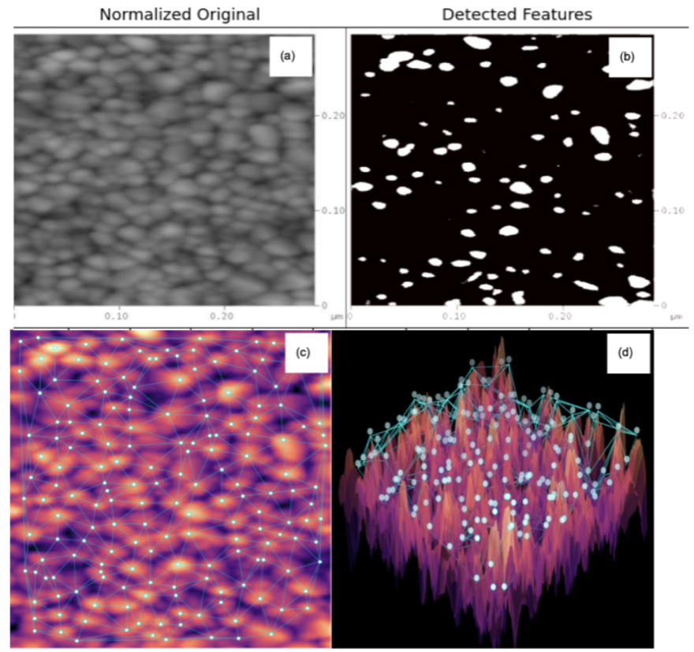

# nano-constellation

**Finding particles in an AFM image of a TiO₂ thin film, joining them into a mesh, and mapping how their spacing varies.**

A hackathon project from the UCD Interdisciplinary Hackathon (December 2025). The TiO₂ film and its AFM scan are from my PhD work.



*(a) Normalised AFM scan. (b) Bright regions above a 50% brightness threshold. (c) Particles found with `peak_local_max`, joined by Delaunay triangulation. (d) The same particles shown above the surface in 3D.*

## The idea

An AFM image of a thin film is a landscape of small bumps. I wanted to see what happens if you treat each bump like a star: find them, join the nearest ones, and look at the pattern they make. The result looks a lot like a constellation, which is where the name comes from, and it also gives a quick way to see where particles sit closer together or further apart.

## How it works

1. **Clean up the image:** convert to grayscale, scale to 0 to 1, and crop the edges (more on the right, where the scan has a saturated bright band).
2. **Find particles:** `skimage.feature.peak_local_max` finds the brightest point of each particle, with a minimum gap of 15 pixels so one particle isn't counted twice.
3. **Join them up:** `scipy.spatial.Delaunay` connects each particle to its natural neighbours.
4. **Map the spacing:** each connection is coloured by its length. Connections on the outer edge of the mesh are left out, because they tend to be long and misleading.
5. **View in 3D:** the image is drawn as a surface with the particles floating above it.

All the settings (crop sizes, thresholds, minimum gap) are in one cell at the top of the notebook, so they're easy to change.

## Run it yourself

Open [`nano_constellation.ipynb`](nano_constellation.ipynb) in Jupyter or Google Colab. It needs:

```
numpy, pandas, matplotlib, scikit-image, scipy
```

The notebook reads the scan from `data/TiO2_film.png` and saves the particle positions to `particle_coordinates.csv`.

## What this is and isn't

This was built in a hackathon, so it's an exploration rather than a finished measurement tool.

- It works on an exported AFM **image**, where brightness stands in for height. Running it on the raw height data would make the numbers quantitative.
- Distances are in **pixels**; converting them to nanometres needs the scan's pixel size.
- The number of particles found depends on the settings, so results should be read together with them.

---

Sinny J. Trivedi · [ORCID](https://orcid.org/0009-0003-8756-3796) · [LinkedIn](https://www.linkedin.com/in/sinny-trivedi-72a1851a)
